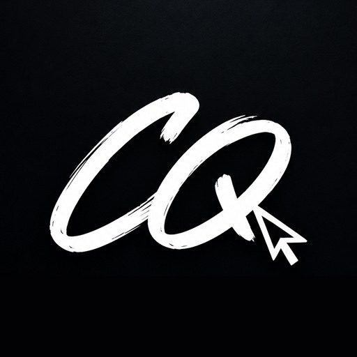

<a href="README.md">🇪🇸 Versión en español</a>

# Carlos Quintero

### Full Stack Developer + Graphic Designer

**Code that works. Design that feels.**

I build digital products end to end: web applications, visual identities and pieces that connect with people.

---

## About me

I'm a **Full Stack Web Developer** and **Advertising Graphic Designer** based in Medellín, Colombia. I currently work as a **Software Developer** and also take on **graphic design** work, which lets me see every product from two angles: the code and the brand.

- **End-to-end development:** React and TypeScript interfaces, APIs, databases and deployment.
- **Visual identity:** branding, advertising pieces, social content and editorial design.
- **Hybrid profile:** technical decisions informed by design, and vice versa.

> I build experiences that solve and inspire. Every line of code and every pixel has a purpose.

---

## Stack

**Frontend**

**Backend & data**

**Design**

**Tools**

---

## Selected work

| Project | What it is | Stack | Demo |
| :-- | :-- | :-- | :--: |
| **Construcciones ARQ** | Corporate website for a construction firm: dark art direction, project catalogue and micro-interactions. | Web design · Motion · Responsive | [View](https://construccionesarq.netlify.app/) |
| **Recordatorios Familiares** | App to organise household tasks with automatic email reminders. | Full Stack · Cloudflare Workers · Auth | [View](https://app.recordatoriosfamiliares.workers.dev/) |
| **Deluxe Agenda** | Agenda for professionals: appointments, clients, income and cloud backup. | Full Stack · Dashboard · Google Auth | [View](https://deluxe-agenda.netlify.app/) |
| **Shoppa** | Shopping list manager with multiple lists, dark mode and a focus on productivity. | UI/UX · Productivity · Responsive | [View](https://shoppalist.netlify.app/) |
| **Natalia Cosmetóloga** | Landing page for a beauty and lash studio with WhatsApp booking. | Landing · UI Design · WhatsApp | [View](https://nataliacosmetologa.netlify.app/) |

*Some are client projects; their code is private.*

**[See all projects →](https://portfoliocarlosquintero.netlify.app/)**

---

## How I work

1. **Discover** — goal, audience and what success looks like.
2. **Design** — visual direction, structure and prototypes before writing code.
3. **Build** — clean, typed code with attention to performance and accessibility.
4. **Launch** — deployment, measurement and continuous improvement.

---

## Contact

- **Portfolio:** [portfoliocarlosquintero.netlify.app](https://portfoliocarlosquintero.netlify.app/)
- **LinkedIn:** [in/carlosquintero8](https://www.linkedin.com/in/carlosquintero8/)
- **Email:** [mrcarlosquintero8@gmail.com](mailto:mrcarlosquintero8@gmail.com)
- **Location:** Medellín, Colombia · Remote work

Open to freelance projects, collaborations and full-time opportunities.
