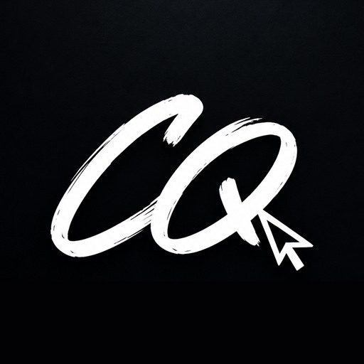

<a href="README.en.md">🇬🇧 English version</a>

# Carlos Quintero

### Full Stack Developer + Graphic Designer

**Código que funciona. Diseño que se siente.**

Construyo productos digitales de principio a fin: aplicaciones web, identidades visuales y piezas que conectan con las personas.

---

## Sobre mí

Soy **Desarrollador Web Full Stack** y **Diseñador Gráfico Publicitario** desde Medellín, Colombia. Actualmente trabajo como **Desarrollador de Software** y también asumo funciones de **diseño gráfico**, lo que me permite ver cada producto desde dos ángulos: el código y la marca.

- **Desarrollo end-to-end:** interfaces con React y TypeScript, APIs, bases de datos y despliegue.
- **Identidad visual:** branding, piezas publicitarias, contenido para redes y diseño editorial.
- **Perfil híbrido:** decisiones técnicas informadas por el diseño, y viceversa.

> Construyo experiencias que resuelven y emocionan. Cada línea de código y cada píxel tienen un propósito.

---

## Stack

**Frontend**

**Backend y datos**

**Diseño**

**Herramientas**

---

## Proyectos destacados

| Proyecto | Qué es | Stack | Demo |
| :-- | :-- | :-- | :--: |
| **Construcciones ARQ** | Sitio corporativo para una constructora: dirección de arte oscura, catálogo de proyectos y microinteracciones. | Diseño web · Motion · Responsive | [Ver](https://construccionesarq.netlify.app/) |
| **Recordatorios Familiares** | App para organizar las tareas del hogar con recordatorios automáticos por correo. | Full Stack · Cloudflare Workers · Auth | [Ver](https://app.recordatoriosfamiliares.workers.dev/) |
| **Deluxe Agenda** | Agenda para profesionales: citas, clientes, ingresos y respaldo en la nube. | Full Stack · Dashboard · Google Auth | [Ver](https://deluxe-agenda.netlify.app/) |
| **Shoppa** | Gestor de listas de compras con múltiples listas, modo oscuro y enfoque en productividad. | UI/UX · Productividad · Responsive | [Ver](https://shoppalist.netlify.app/) |
| **Natalia Cosmetóloga** | Landing para un estudio de cosmética y pestañas, con reservas por WhatsApp. | Landing · UI Design · WhatsApp | [Ver](https://nataliacosmetologa.netlify.app/) |

*Algunos son proyectos de clientes; su código es privado.*

**[Ver todos los proyectos →](https://portfoliocarlosquintero.netlify.app/)**

---

## Cómo trabajo

1. **Descubrir** — objetivo, audiencia y qué significa el éxito.
2. **Diseñar** — dirección visual, estructura y prototipos antes de escribir código.
3. **Construir** — código limpio y tipado, con atención al rendimiento y la accesibilidad.
4. **Lanzar** — despliegue, medición y mejora continua.

---

## Contacto

- **Portafolio:** [portfoliocarlosquintero.netlify.app](https://portfoliocarlosquintero.netlify.app/)
- **LinkedIn:** [in/carlosquintero8](https://www.linkedin.com/in/carlosquintero8/)
- **Email:** [mrcarlosquintero8@gmail.com](mailto:mrcarlosquintero8@gmail.com)
- **Ubicación:** Medellín, Colombia · Trabajo remoto

Abierto a proyectos freelance, colaboraciones y oportunidades full-time.
